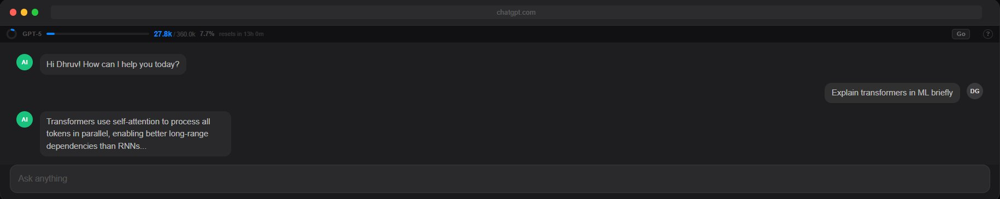
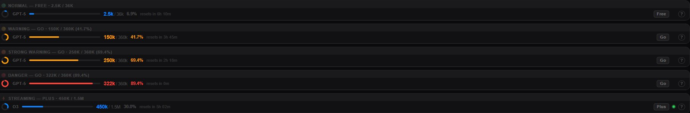

# ChatGPT Counter

A lightweight browser extension that tracks your **daily token usage** on [chatgpt.com](https://chatgpt.com) — with a real-time progress bar, model detection, and plan-aware limits.



---

## What It Looks Like

The counter bar sits at the top of every ChatGPT page and updates live as you chat.



Color changes based on how much of your daily limit you've used:
- 🔵 **Blue** — Normal usage
- 🟠 **Orange** — Warning (approaching limit)
- 🔴 **Red** — Danger (near limit)
- 🟢 **Pulsing dot** — ChatGPT is currently generating

---

## Features

- **Daily token tracking** — counts tokens across all chats, resets automatically at midnight
- **Per-chat memory** — switching between chats doesn't inflate your total
- **Model detection** — auto-detects GPT-4o, GPT-5, o3, o4-mini, GPT-4.1, etc.
- **Plan selector** — pick Free / Go / Plus / Pro to see the right limits and thresholds
- **Reset timer** — shows exactly how long until your daily count resets
- **Zero config** — no API key, no login, no setup required

---

## Plan Limits

| Plan | Daily Limit | Warn at | Danger at |
|------|-------------|---------|-----------|
| Free | 36K | 27K | 33K |
| Go | 360K | 150K | 250K |
| Plus | 1.5M | 750K | 1.25M |
| Pro | 5M | 2.5M | 3.75M |

> ⚠️ These limits are estimated from observed behavior — OpenAI doesn't publish official daily token caps. Treat numbers as a helpful approximation, not an exact meter.

---

## Installation

### Step 1 — Download the extension

Click **Code → Download ZIP** on this page, then unzip the folder.

Or clone with git:
```
git clone https://github.com/YOUR_USERNAME/chatgpt-counter.git
```

---

### Step 2 — Open Chrome Extensions

In your browser address bar, go to:
```
chrome://extensions
```

---

### Step 3 — Enable Developer Mode

Toggle **Developer mode** on in the **top-right corner** of the extensions page.

---

### Step 4 — Load the extension

Click **Load unpacked**, then select the `chatgpt-counter-apple` folder (the one that contains `manifest.json`).

> 💡 **Tip:** You can also drag and drop the entire `chatgpt-counter-apple` folder directly onto the `chrome://extensions` page — it loads automatically.

---

### Step 5 — You're done

Go to [chatgpt.com](https://chatgpt.com) and the counter bar will appear at the top of the page.

---

## Browser Compatibility

| Browser | Supported |
|---------|-----------|
| Chrome | ✅ |
| Edge | ✅ |
| Brave | ✅ |
| Arc | ✅ |
| Firefox | ⚠️ Partial (Manifest V3 differs) |

---

## Privacy

- No external network requests — all data stays in your browser
- Only runs on `https://chatgpt.com/*`
- No analytics, no tracking, no background service worker
- Only permission used: `storage` (to remember your daily total and plan)

---

## Project Structure

```
chatgpt-counter-apple/
├── manifest.json              # Extension manifest (v3)
├── icons/
│   ├── icon16.png
│   ├── icon48.png
│   └── icon128.png
└── src/
    ├── styles.css             # Counter bar styles
    └── content/
        ├── constants.js       # Model limits, plan limits, thresholds
        ├── ui.js              # Counter bar UI component
        └── main.js            # Token counting, navigation, storage
```

---

## License

MIT
